<!-- Profile README for github.com/ganesh-786. Source of truth: ganeshtharu.com.np and the resume. -->

# Ganesh Chaudhary

**Full-Stack Developer** &nbsp;·&nbsp; React · TypeScript · Node.js · PostgreSQL · AI integrations 
Kathmandu, Nepal (UTC+5:45) &nbsp;

---

## About

I build web products end to end: the React interface, the API behind it, the database it depends on, and getting it live. I have 1+ year in professional teams and have been building for the web since 2023. I started on the design side, turning Figma wireframes into responsive layouts, and I still care about accessibility, readable code and honest code review.

## Now: Software Developer (Contract), Looma Education

Built semantic search and a "Chat with Looma" RAG assistant for Looma's offline education device, used in schools in Nepal.

## Featured: UnTangler at Compass Decisions Science LLC (Jul – Nov 2026)

Built **UnTangler**, a production voice-first PWA that helps students with ADHD turn an overwhelming task into small steps on their Google Calendar.

- Integrated **Gemini Live** for voice task creation. Backend-issued single-use tokens let the browser connect directly, so the API runs as one Vercel serverless function with no WebSocket proxy.
- Built **Google Calendar, Tasks and Classroom** sync with completion write-back, plus timezone-aware handling of spoken times such as "tomorrow at 5".
- Designed the end-of-day check-in flow: Web Push, in-app notifications and a scheduled dispatch job.
- Ran an app-wide accessibility audit and fixed it to **WCAG AA**. Set up CI with GitHub Actions and versioned Supabase migrations.
- Team of two developers and a product owner, every change reviewed in a pull request. Closed 88 of 89 assigned Jira tickets and wrote 160 of 286 non-merge commits (Jul–Sep 2026).

`React 19` `TypeScript` `Express 5` `Zod` `Supabase` `Gemini Live` `Google APIs` `Web Push` `Vercel` `Vitest`

[Read the UnTangler case study →](https://www.ganeshtharu.com.np/projects/untangler)

## Selected work

| Project | What it does · my part | Built with |
|---|---|---|
| **E-commerce Order Management System** [Case study](https://www.ganeshtharu.com.np/projects/ecommerce-order-system) · [Code](https://github.com/TEJ-Fellowship/pbl/tree/Eganesh/PBL5/6_E-commerce_Orders) | Stops double-selling the last item and checkout freezes during payment. Team project: I designed the system and wrote most of it. Express API on a PostgreSQL primary with two read replicas, Redis caching, a Kafka payment worker and k6 load tests. | Node.js, Express, PostgreSQL, Redis, Kafka, Docker Compose, React, k6 |
| **Shopify Merchant Support Agent** [Case study](https://www.ganeshtharu.com.np/projects/shopify-support-agent) · [Code](https://github.com/TEJ-Fellowship/pbl/tree/latency/PBL4/ShopifyMerchantSupportAgent) | Answers merchant questions from Shopify's documentation and reads real store data. Team project: I built most of the RAG pipeline (chunking, Pinecone embeddings, hybrid search, MCP tools, caching) and the dashboard. Latency analysis put answers at about 3.5 s. | Node.js, Express, Gemini API, Pinecone, FlexSearch, MongoDB, MCP, React |
| **Trihutbaba** (in progress) [Case study](https://www.ganeshtharu.com.np/projects/trihutbaba-store) · [Code](https://github.com/ganesh-786/TrihutBaba) | Online store for an agriculture supply shop in Nepal, in English and Nepali, with eSewa and Khalti payments and an owner admin area. Solo, end to end. | Next.js 15, TypeScript, Supabase, Drizzle ORM, next-intl, Tailwind CSS |
| **Gyaan Tapari** [Live demo](https://gyaan-tapari.vercel.app/) · [Case study](https://www.ganeshtharu.com.np/projects/gyaan-tapari) · [Code](https://github.com/TEJ-Fellowship/pbl/tree/main/PBL3/Gyaan_Tapari) | Learning game for grades 8 and 9: quizzes, typing race and hangman, with points, levels and streaks. Solo, end to end. | React, Vite, Tailwind CSS, Gemini API |
| **Citizenship Verification System** [Case study](https://www.ganeshtharu.com.np/projects/citizenship-verification) · [Code](https://github.com/aachaltiwari/Document-Verification) | University capstone, team of four. Checks a Nepali citizenship card against typed details and the photo. My part: front-end development. | Python, Django, YOLO, TrOCR, OpenCV, Bootstrap |

[See all projects →](https://www.ganeshtharu.com.np/projects)

## Experience

| Role | Company | Dates | Highlight |
|---|---|---|---|
| Software Developer (Contract) | Looma Education | Oct 2026 – Present | Semantic search and a "Chat with Looma" RAG assistant for an offline education device used in schools in Nepal |
| Full-Stack Developer | Compass Decisions Science LLC | Jul 2026 – Nov 2026 | Built UnTangler, a production voice-first PWA: Gemini Live voice, Google Calendar sync, WCAG AA |
| Junior Software Developer | TEJ Center Private Limited | Jan 2026 – Jul 2026 | React interfaces for 2 enterprise client applications |
| Software Developer Fellow | TEJ Center Private Limited | Jul 2025 – Dec 2025 | RAG support agent, event-driven order system |
| Web Design Intern | Nobel PBC Learning | May 2025 – Jul 2025 | Figma UI, user-flow research, accessibility audits |
| Front-End Developer (Remote) | Freelance | 2023 – 2025 | JavaScript dashboards for training platforms |

## Tech stack

  

| Area | Technologies |
|---|---|
| **Languages** | TypeScript, JavaScript, Python, SQL, HTML, CSS |
| **Frontend** | React, Next.js, Tailwind CSS, Progressive Web Apps, Accessibility (WCAG AA) |
| **Backend** | Node.js, Express, Django, REST APIs, WebSockets, event-driven architecture |
| **Data** | PostgreSQL, Supabase, MongoDB, Redis, Pinecone |
| **AI** | Gemini API, Gemini Live, RAG, Model Context Protocol (MCP), YOLO, TrOCR |
| **Delivery** | Git, GitHub Actions, Docker, Kafka, Vercel, Vitest, k6, Jira, Figma |

## GitHub activity

<!-- Generated daily by .github/workflows/update-readme-stats.yml and committed to this repo. -->

  
  

## Education and certifications

- **Bachelor of Computer Engineering**, Institute of Engineering (IOE), Dharan Campus · 2021 – 2025
- **Full Stack Open**, University of Helsinki · 7 ECTS, Grade 5 · 2025 · [Verify](https://studies.cs.helsinki.fi/stats/api/certificate/fullstackopen/en/fba3bdf793a076746b18088b82237aca)
- **Claude Code in Action**, Anthropic Academy · 2026 · issued as Ganesh Tharu · [Verify](https://verify.skilljar.com/c/kw9drjq2b2d5)

## Work with me

**Hiring for a full-time role?** My [resume](https://www.ganeshtharu.com.np/resume) and [LinkedIn](https://www.linkedin.com/in/ganesh-chaudhary) have the details, or email [ganesh98245.np@gmail.com](mailto:ganesh98245.np@gmail.com).

**Have a project?** I take freelance work part-time, evenings and weekends, Nepal time. I reply within two working days, and you get a written scope and a fixed price before any work starts. [Discuss your project →](https://www.ganeshtharu.com.np/#contact)
